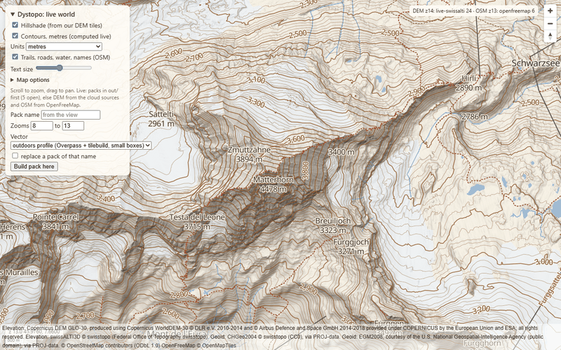
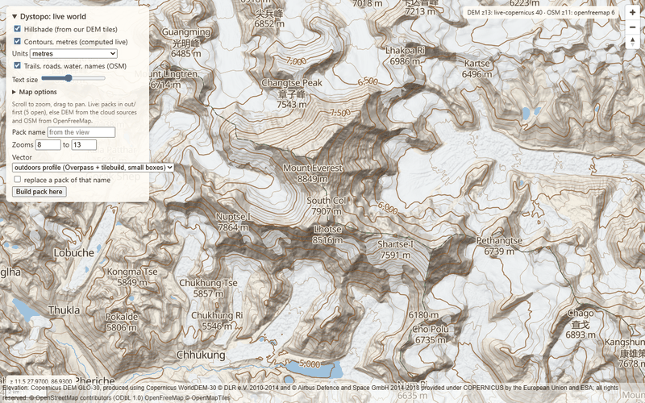
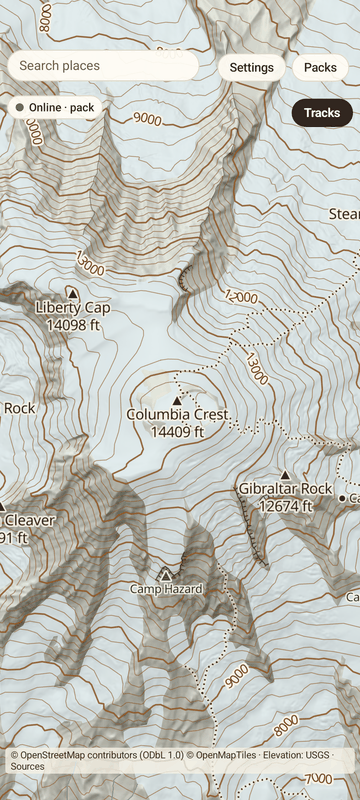
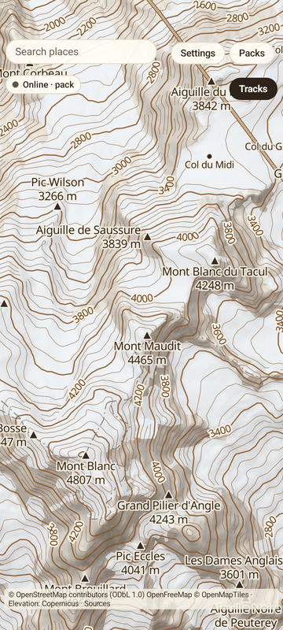
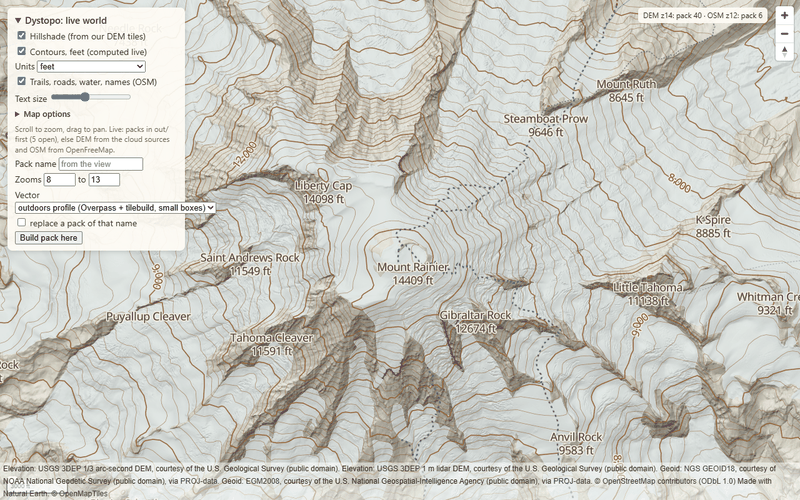
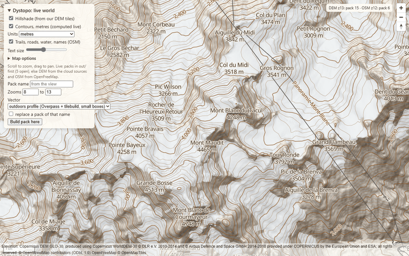
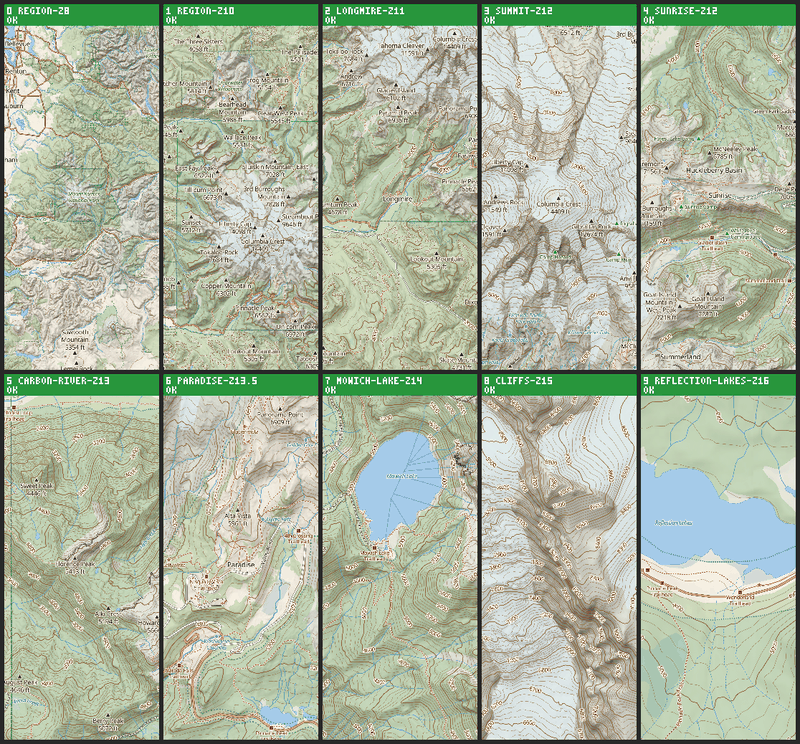

# Dystopo

[](https://github.com/jasondorjeshort/dystopo/actions/workflows/ci.yml)

Open-source, offline-first topographic maps for the backcountry. Dystopo builds its own hillshade, slope shading
and labelled contours from public elevation data (USGS 3DEP lidar, swissALTI3D, Copernicus), draws OpenStreetMap
trails, water and names over them, and packs a region into files a phone can use with no signal. Android first;
a server and a desktop tool come with it, iOS later.

<p>


</p>
<p>



</p>
<p>


</p>

**Status (October 2026): working and tested, not yet released.** No version has been published; the APKs that
a release will carry can be built from source today (below). Expect rough edges.

## Features

**Terrain**
- Elevation read straight from public cloud files: USGS 3DEP (10 m, and 1 m lidar where flown), swissALTI3D
  (Switzerland, 0.5 to 2 m), Copernicus GLO-30 (the rest of the world, 30 m). All converted to one vertical datum
  (EGM2008) and blended with feathered seams, so source edges do not show.
- Hillshade (single or multi-directional), CalTopo-style slope-angle shading, contours with readable intervals
  per zoom, index lines and labels in feet or metres.

**Map**
- OpenStreetMap trails, roads, water, glaciers, peaks with elevations, huts and place names, from an outdoors
  profile built with Planetiler, or from OpenFreeMap tiles anywhere in the world.
- Region packs are standard [PMTiles](https://github.com/protomaps/PMTiles) archives (elevation and vectors) that
  other PMTiles tools can open.

**Android app** (Compose + MapLibre Native)
- Fully offline with a region pack: hillshade, trails and contours generated on the phone.
- Online browsing anywhere through a Dystopo server, and "download this region" as a pack; a pack catalog with
  hash-verified downloads.
- Track recording with waypoints, elevation profiles and GPX import/export; offline place search; route planning
  along trails, offline.
- Map options: hillshade style and strength, slope shading, contour interval and label density, layers, night mode.
- Sync of tracks, waypoints and settings between devices: through a file, an always-on server, or directly with
  another phone on the same Wi-Fi or anywhere through the server relay (an end-to-end encrypted 16-character code or QR), with a deterministic merge.
- A 14 MB release APK per CPU type.

**Server and desktop**
- `devtool serve --live` renders any place on earth on demand in the browser and builds packs for a box.
- A standalone server (config file, pack catalog, token, Dockerfile) that the phone browses, downloads from and
  syncs with.
- A command-line tool (`devtool`) that renders PNGs, inspects PMTiles and vector tiles, plans routes and runs a
  sync simulator, all printing JSON.

**Tested by machines**: everything is driven through JSON-speaking tools and a debug server in the app, so the
world tour (27 public places), a browser tour and a device tour on an emulator run on every change, with golden
images for rendering. See [CONTRIBUTING.md](CONTRIBUTING.md).

## Try it

Requires JDK 21 and Git. On Windows use `gradlew` in place of `./gradlew`. Downloaded data is cached in `cache/`
and output goes to `out/`.

### Desktop: render and browse

```
./gradlew check                                        # build and run all tests
./gradlew :devtool:run --args="render --area rainier"  # out/rainier-best-z13.png and a JSON report
./gradlew :devtool:run --args="areas"                  # the named public areas
./gradlew :devtool:run --args="serve --live --port 8687"
```

Then open http://localhost:8687/ for the live viewer: pan anywhere, and the elevation and base map are fetched
and rendered on demand (the first view of a new place takes 10 to 30 s; after that it is cached). The panel builds
a pack of the visible box. All commands: `./gradlew :devtool:run --args="--help"`, and [CLAUDE.md](CLAUDE.md).

### Server

```
./gradlew :server:installDist
server/build/install/server/bin/server        # 0.0.0.0:8080; --config my-server.json, --print-config
```

It serves live hillshade, contours and base map anywhere, builds and hosts region packs, lists them in a catalog
and is the always-on sync peer for phones. Configuration, Docker, TLS behind a reverse proxy, the token and the
limits: [docs/SERVER.md](docs/SERVER.md).

### Phone

Needs the Android SDK (`powershell -ExecutionPolicy Bypass -File tools\android-sdk.ps1` installs one on Windows
without admin rights and writes `local.properties`).

```
./gradlew :androidApp:assembleDebug        # androidApp/build/outputs/apk/debug/androidApp-debug.apk
./gradlew :androidApp:assembleRelease      # one APK per CPU type in androidApp/build/outputs/apk/release/
```

**On a real phone.** Install the APK for its CPU (`androidApp-arm64-v8a-release.apk` on almost every phone made
since 2017, or the universal one): copy it over and open it (allow installs from that app), or `adb install`. The
first start has no map yet and says so, with three ways to get one, all in the app:

- **Set your server, then download.** Run the server on a computer at home (above), open Settings › Sources on the
  phone, type its address, for example `http://192.168.1.20:8080` (the computer's address on your Wi-Fi), tap Save
  and Test: Test shows how many packs the server has. Then "Download the map around me" (your location; the server
  builds the pack) or "Choose from server" (its catalog). Plain `http://` works only for home-network addresses
  (10.x, 172.16-31.x, 192.168.x, 169.254.x, `.local` names); a server reachable from the internet needs `https://`
  (TLS in front of it: docs/SERVER.md).
- **Import pack files.** Copy `<name>-dem.pmtiles` (and `<name>-outdoors.pmtiles`, the trails and names) to the
  phone, tap "Import pack files" and pick both. Labels need the fonts, which the app fetches from a server once one
  is set.
- **Push from a computer** (developers): `tools\android-release.ps1 -Serial <serial> -Name <pack>` installs the
  release build and pushes `out\<pack>-dem.pmtiles` and its glyphs and sprites; `tools\android-push-pack.ps1` does
  the same for the debug build.

Build packs with the live viewer's "Build pack here", the server's `/build`, or `devtool tiles` and `tilebuild`
(see CLAUDE.md). `tools\android-emu.ps1 -Build` boots a headless emulator, installs the debug app and pushes the
Rainier pack in one step.

## Documentation

- [docs/PLANNING.md](docs/PLANNING.md): design, decisions and the development log with measurements.
- [docs/TASKS.md](docs/TASKS.md): the task board.
- [docs/SERVER.md](docs/SERVER.md): running the server.
- [CLAUDE.md](CLAUDE.md): every command and convention (written for the coding agents that build most of Dystopo).
- [CONTRIBUTING.md](CONTRIBUTING.md): how work is done here, privacy and licence rules.
- [CHANGELOG.md](CHANGELOG.md): what has been merged.

## Licence

- **Code**: GNU General Public License v3 ([LICENSE](LICENSE)). The project may also offer other terms later
  (for example an app-store exception); that is why its own dependencies are kept permissive.
- **Dependencies**: all permissively licensed (Apache-2.0, MIT, BSD, EPL and similar), enforced by the build;
  the build-side OSM tool may use LGPL libraries. Full list with versions: [NOTICES.md](NOTICES.md).
- **Map data keeps its sources' licences**: OpenStreetMap data is ODbL 1.0 (© OpenStreetMap contributors), so
  vector packs built from it are ODbL too; USGS 3DEP is public domain; Copernicus DEM is free with attribution;
  swissALTI3D is free with the source named (swisstopo). Every pack and rendered image records its sources, and
  the app shows the credits for what is on screen. Details: [NOTICES.md](NOTICES.md) and
  [docs/PLANNING.md › Licensing](docs/PLANNING.md#licensing).
- Text in rendered images uses Noto Sans (SIL Open Font License 1.1).

Screenshots: the browser views come from `tools/demo-check.py` against `devtool serve --live`, the phone views
from the app's debug server on an emulator. All show public places.
