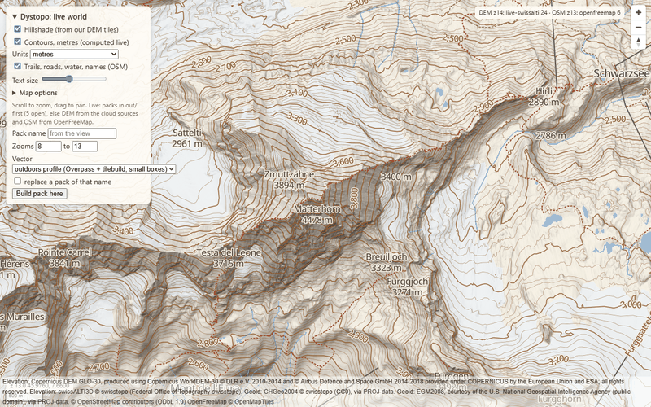
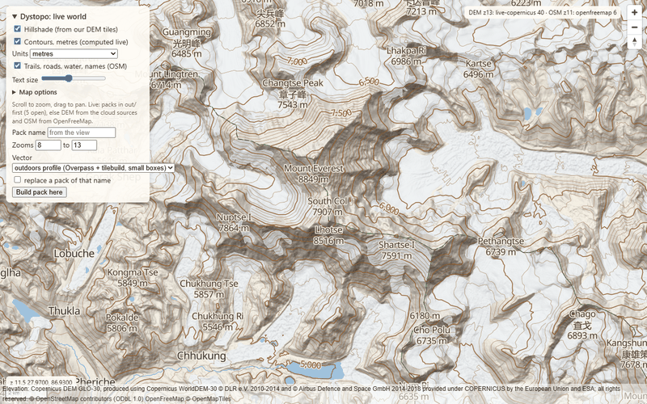
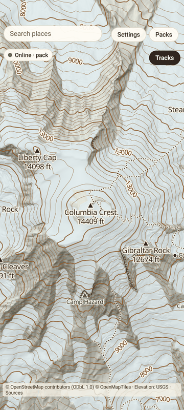
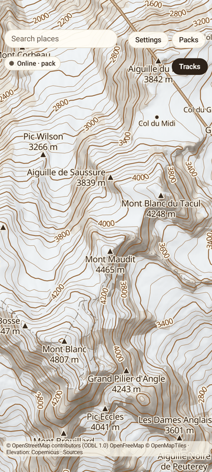
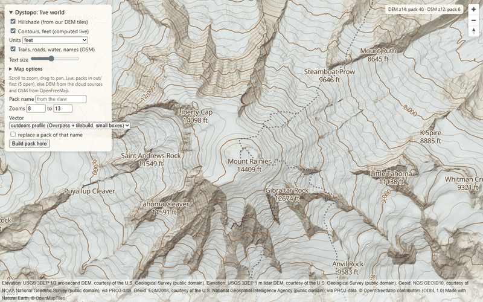
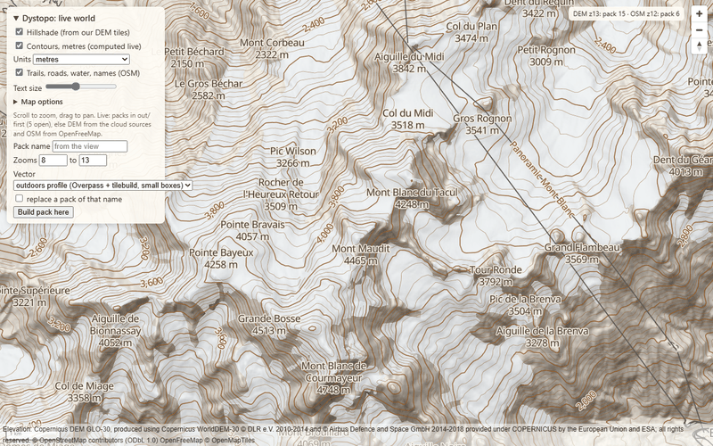
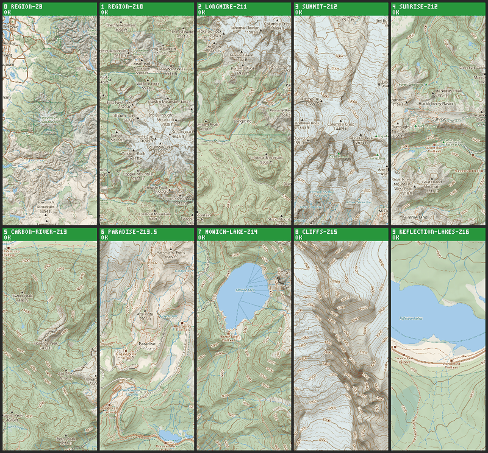

# Dystopo

[](https://github.com/jasondorjeshort/dystopo/actions/workflows/ci.yml)

Open-source, offline-first topographic maps for the backcountry. Dystopo builds its own hillshade, slope shading
and labelled contours from public elevation data (USGS 3DEP lidar, swissALTI3D, Copernicus), draws OpenStreetMap
trails, water and names over them, and packs a region into files a phone can use with no signal. Android first;
a server and a desktop tool come with it, iOS later.

<p>


</p>
<p>



</p>
<p>


</p>

**Status (November 2026): alpha, [v0.1.44-alpha](https://github.com/jasondorjeshort/dystopo/releases/tag/v0.1.44-alpha) (one universal APK, server and devtool zips). Wave 49, mostly fixes: search and the peak names of the Horizon, Panorama and List work inside a downloaded area with no offline map; "Keep a folder" on Tracks and routes writes every track and route as a GPX file into a folder you pick and keeps it up to date, removing a file only when you delete its track; a Coordinate format setting (decimal degrees, degrees and minutes, degrees minutes seconds, or UTM) for the glance view, a long press and waypoints; a saved area has a Detail sheet to raise or lower its detail; a long press names every dot and symbol on the map; the glance view says what it is doing while GPS searches and shows the position with its accuracy, and two lines tell a wrong GPS clock from a wrong phone clock; a first launch moves to your position when the first fix arrives; the activity picker no longer covers the recording panel; the app does no work in the background unless a notification says so, and the tile store's housekeeping no longer runs there. Wave 48, v0.1.44-alpha: one answer to what the phone holds at a place, used by the map, the Horizon and Panorama, the status chip, the Download card, search and the elevation readout (the finest of an offline map, a downloaded area, tiles viewed earlier, then online); finer terrain from online is fetched behind what the phone holds and swapped in without a blank; shading and contours blend at the edge of a detailed map instead of stepping; the status chip's card lists what the phone holds at the centre of the view; saved maps are outlined by their detail level with a label and a key; the readout bar's elevation holds through a GPS jump, and a dimmed or "?" value says why in the glance view; flights on the map have their own switch and flight tracking moved to Data and storage; with no server set a download stays inside the public map source's limits (3,000 map tiles and 50 MB) and a trip's map waits for a tap; a freeze at the largest text size fixed. Wave 47, v0.1.43-alpha: the Horizon view and the Panorama read the land one way, the finest offline map first, a coarser one where it ends, then online, and the peaks come from whichever map has them; a map that fails to open is listed with its reason; each offline map can be switched off without deleting it; the Download card says what the phone already holds there and offers nothing where nothing would be new; the status chip reads Offline in airplane mode; at country scale the map fetches the richer online map behind the world overview ("More detail from online", on by default); the Panorama fills the screen, its list moved to a fourth view, List (Map | Horizon | Panorama | List); a recording left without a location for days is asked about instead of giving a turn-back time; the map opens about 50 ms sooner. Wave 46, v0.1.42-alpha: air pressure has its own unit setting (mbar by default; hPa, inHg or mmHg), apart from feet and metres; the Panorama can follow the phone as you point it (a Follow phone button and a setting), with a drag to adjust the compass and a note when the compass needs calibrating; a long-pressed place says whether you can see it from where you stand, or how far away the ridge that hides it is; a note while recording when the GPS signal stays unusually weak; and a phone that holds a downloaded area no longer says it has no map. Wave 45, v0.1.41-alpha: the Panorama view on the phone, the third segment of the switch (Map | Horizon | Panorama): the land's skyline in layers as you would see it looking sideways, with the peaks' names, today's sun and its path, the GPS satellites and the flights; drag to turn and tilt, pinch or use two buttons to zoom, tap a row or a name to turn to it, and an arrow at the edge points back to it when it is out of view; the Horizon view's Close button is gone (the Map segment and Back leave it); a crash of debug builds at launch after a reinstall fixed. Wave 44, v0.1.40-alpha: a peak picked in the Horizon view has a "View from here" button that shows the sky from its top, and the Horizon switch opens at the place selected on the map (a long-pressed point or a search result); the first-run card takes its place among the map's controls instead of covering them; under it, the first pass of a Panorama view (the lens and its names, in the tools only so far). Wave 43, v0.1.39-alpha: the Map | Horizon switch sits in the same bottom-left place in both views; flights can refresh every 2 or 3 minutes, the line under the setting says how long the day's requests last, and a flight's card says how high it is above the ground; "Sky from here" on the long-press card shows another place's sky, with an amber line saying where it is and Back to here. Wave 42: a tapped flight shows a dotted estimate of its path from the origin airport to where the phone first saw it, and a setting draws faint route lines on every flight to compare; a rare crash after turning the phone with flights on fixed. Wave 41: Flights, off until turned on in Settings: live aircraft around the map you are viewing, drawn by kind with trails, call sign and route ("SEA > DEN") where the schedule data fits, a card with altitude, speed, distance and direction; and the same flights as dots in the Horizon view, hollow behind the terrain, with a list closest first (a preliminary v0.1.36-alpha went out first for testing on the phone). Wave 40, v0.1.35-alpha: a Map | Horizon switch on the map, and the Horizon view names the closest peaks first, including one just hidden behind nearer ground. Wave 39: the Horizon view, a square sky plot with buttons to show the peaks on your skyline, today's sun with when it clears and leaves the ridge, and the GPS satellites. Before it, v0.1.33-alpha (wave 38): a GPS status screen with the satellites, the land's skyline from the offline map and a two-minute "Check my GPS" (Healthy, Weak signal or May be a hardware fault). Before it, v0.1.32-alpha (wave 35): Report a problem's diagnostics end in Share and Open GitHub issue, and "Report recent stats" sends a phone's start times, tile store and memory without names or places; the rest was the tools that test each build (retries, a public-area label on every test screenshot, one signing script). Before it, v0.1.31-alpha (wave 34) was tooling, and showed the card's fuel saving on town drives to be overstated (the fix is next); v0.1.30-alpha (wave 33) made drive routes pay for their turns, so a side road reached by two left turns no longer beats the main road, and added a setting that plans drives for least time, for least fuel (an estimate for an average car, with the saving against the least-time route on the card) or quickly, without the turns; v0.1.29-alpha moved kept maps out of the app's cache, added the activity chip and folded the route card's backcountry lines into one Trip details row. Tested on emulators, and from wave 36 the sweep also runs on a real phone over wireless debugging (`tools/sweep.ps1 -Phone`), a debug build installed beside the release app without touching it.**
a release will carry can be built from source today (below). Expect rough edges.

## Features

**Terrain**
- Elevation read straight from public cloud files: USGS 3DEP (10 m, and 1 m lidar where flown), swissALTI3D
  (Switzerland, 0.5 to 2 m), Copernicus GLO-30 (the rest of the world, 30 m). All converted to one vertical datum
  (EGM2008) and blended with feathered seams, so source edges do not show.
- Hillshade (single or multi-directional), slope shading (avalanche slope angles or plain steepness), contours with readable intervals
  per zoom, index lines and labels in feet or metres.

**Map**
- OpenStreetMap trails, roads, water, glaciers, peaks with elevations, huts and place names, from an outdoors
  profile built with Planetiler, or from OpenFreeMap tiles anywhere in the world.
- Region packs are standard [PMTiles](https://github.com/protomaps/PMTiles) archives (elevation and vectors) that
  other PMTiles tools can open.

**Android app** (Compose + MapLibre Native)
- Fully offline with a region pack: hillshade, trails and contours generated on the phone.
- Online browsing anywhere through a Dystopo server, and "download this region" as a pack; a pack catalog with
  hash-verified downloads.
- Track recording with waypoints, elevation profiles and GPX import/export; offline place search; route planning
  along trails, offline.
- Map options: hillshade style and strength, slope shading, contour interval and label density, layers, night mode.
- Sync of tracks, waypoints and settings between devices: through a file, an always-on server, or directly with
  another phone on the same Wi-Fi or anywhere through the server relay (an end-to-end encrypted 16-character code or QR), with a deterministic merge.
- A 14 MB release APK per CPU type.

**Server and desktop**
- `devtool serve --live` renders any place on earth on demand in the browser and builds packs for a box.
- A standalone server (config file, pack catalog, token, Dockerfile) that the phone browses, downloads from and
  syncs with.
- A command-line tool (`devtool`) that renders PNGs, inspects PMTiles and vector tiles, plans routes and runs a
  sync simulator, all printing JSON.

**Tested by machines**: everything is driven through JSON-speaking tools and a debug server in the app, so the
world tour (27 public places), a browser tour and a device tour on an emulator run on every change, with golden
images for rendering. See [CONTRIBUTING.md](CONTRIBUTING.md).

## Try it

Requires JDK 21 and Git. On Windows use `gradlew` in place of `./gradlew`. Downloaded data is cached in `cache/`
and output goes to `out/`.

### Desktop: render and browse

```
./gradlew check                                        # build and run all tests
./gradlew :devtool:run --args="render --area rainier"  # out/rainier-best-z13.png and a JSON report
./gradlew :devtool:run --args="areas"                  # the named public areas
./gradlew :devtool:run --args="serve --live --port 8687"
```

Then open http://localhost:8687/ for the live viewer: pan anywhere, and the elevation and base map are fetched
and rendered on demand (the first view of a new place takes 10 to 30 s; after that it is cached). The panel builds
a pack of the visible box. All commands: `./gradlew :devtool:run --args="--help"`, and [docs/reference/devtool-commands.md](docs/reference/devtool-commands.md).

### Server

```
./gradlew :server:installDist
server/build/install/server/bin/server        # 0.0.0.0:8080; --config my-server.json, --print-config
```

It serves live hillshade, contours and base map anywhere, builds and hosts region packs, lists them in a catalog
and is the always-on sync peer for phones. Configuration, Docker, TLS behind a reverse proxy, the token and the
limits: [docs/SERVER.md](docs/SERVER.md).

### Phone

Needs the Android SDK (`powershell -ExecutionPolicy Bypass -File tools\android-sdk.ps1` installs one on Windows
without admin rights and writes `local.properties`).

```
./gradlew :androidApp:assembleDebug        # androidApp/build/outputs/apk/debug/androidApp-debug.apk
./gradlew :androidApp:assembleRelease      # one APK per CPU type in androidApp/build/outputs/apk/release/
```

**On a real phone.** During alpha the release page offers one file, the universal APK, which runs on every phone; a local build also writes one APK per CPU type (`androidApp-arm64-v8a-release.apk` fits almost every phone made since 2017). Install it: copy it over and open it (allow installs from that app), or `adb install`. The
first start has no map yet and says so, with ways to get one, all in the app:

- **No server: straight from the public sources.** With no server set the phone reads the elevation data itself
  (Copernicus worldwide, USGS 3DEP in the US, the Swiss, Austrian, Norwegian, Canadian and New Zealand national
  models) and the map from OpenFreeMap, and draws hillshade and contours on the phone. "Show the map around me" goes
  to your location; "Download the map around me" saves a 16 km box as a pack on the phone, which then works with no
  network. It works on any network, mobile data included: a first view of a new place downloads tens of megabytes
  and takes about a minute, and the per-session limit in Settings › Sources (300 MB by default) is the brake; mobile
  data can be turned off for it there. Glyphs and map icons come with the app.
- **Set your server, then download.** Run the server on a computer at home (above), open Settings › Sources on the
  phone, type its address, for example `http://192.168.1.20:8080` (the computer's address on your Wi-Fi), tap Save
  and Test: Test shows how many packs the server has. Then "Download the map around me" (your location; the server
  builds the pack) or "Choose from server" (its catalog). Plain `http://` works only for home-network addresses
  (10.x, 172.16-31.x, 192.168.x, 169.254.x, `.local` names); a server reachable from the internet needs `https://`
  (TLS in front of it: docs/SERVER.md).
- **Import.** Copy `<name>-dem.pmtiles` (and `<name>-outdoors.pmtiles`, the trails and names) to the
  phone, tap "Import" and pick both.
- **Push from a computer** (developers): `tools\android-release.ps1 -Serial <serial> -Name <pack>` installs the
  release build and pushes `out\<pack>-dem.pmtiles` and its glyphs and sprites; `tools\android-push-pack.ps1` does
  the same for the debug build.

Build offline maps with the live viewer's "Build a map here", the server's `/build`, or `devtool tiles` and `tilebuild`
(see [docs/reference/](docs/reference/README.md)). `tools\android-emu.ps1 -Build` boots a headless emulator, installs the debug app and pushes the
Rainier pack in one step.

## Installing on a phone

- **Get the APK** from the [releases page](https://github.com/jasondorjeshort/dystopo/releases): during alpha there is one file, `dystopo-<version>-universal.apk`. Open it on the phone and allow installs from your browser when asked. New alphas install over old ones and keep your tracks, trips and settings; every build is signed with the same key.
- **"Google doesn't know this publisher" / blocked by Play Protect:** tap *More details*, then *Install anyway*. That is a one-time choice for this app. The durable fix, registering the publisher and signing key with Google's developer verification, is on the owner's list; until then expect the dialog on first install.
- **Updates, in the app:** once a day (and when you tap *Check for updates* in Settings) the app looks at this
  repository's releases, on Wi-Fi or mobile data. When a newer alpha is out it downloads the universal APK, checks it
  against the release's `SHA256SUMS.txt` and checks that it is signed with the same key as the app you have (it refuses
  and says why otherwise), then shows *Update to <version>* on the map and as a notification. *Install* opens
  Android's installer; the first time, Android asks you to allow installs from Dystopo (*Settings*, switch on, back),
  then *Update*. Your tracks, trips, packs and settings stay. *Not now* (or cancelling the installer) skips that
  version until you check by hand. Android never lets a sideloaded app update itself silently, so the one tap is the
  minimum.
- **Updates, without the app's check:** [Obtainium](https://github.com/ImranR98/Obtainium) works too: add this
  repository, turn on *include pre-releases*, and filter the asset name on `universal`. Or download the new APK from
  the releases page and open it; it installs over the old one.
- **Map data:** first launch offers *Show the map around me* and *Download the map around me* (any network, no server
  needed), a server under Settings › Sources, or importing pack files.

## Documentation

- [docs/PLANNING.md](docs/PLANNING.md): design, decisions and the development log with measurements.
- [docs/TASKS.md](docs/TASKS.md): the task board.
- [docs/SERVER.md](docs/SERVER.md): running the server.
- [CLAUDE.md](CLAUDE.md): the rules for the coding agents that build most of Dystopo; every command, route and setup step is in [docs/reference/](docs/reference/README.md), the decisions in [docs/design/decisions/](docs/design/decisions/README.md).
- [CONTRIBUTING.md](CONTRIBUTING.md): how work is done here, privacy and licence rules.
- [CHANGELOG.md](CHANGELOG.md): what has been merged.

## Licence

- **Code**: GNU General Public License v3 ([LICENSE](LICENSE)). The project may also offer other terms later
  (for example an app-store exception); that is why its own dependencies are kept permissive.
- **Dependencies**: all permissively licensed (Apache-2.0, MIT, BSD, EPL and similar), enforced by the build;
  the build-side OSM tool may use LGPL libraries. Full list with versions: [NOTICES.md](NOTICES.md).
- **Map data keeps its sources' licences**: OpenStreetMap data is ODbL 1.0 (© OpenStreetMap contributors), so
  vector packs built from it are ODbL too; USGS 3DEP is public domain; Copernicus DEM is free with attribution;
  swissALTI3D is free with the source named (swisstopo). Every pack and rendered image records its sources, and
  the app shows the credits for what is on screen. Details: [NOTICES.md](NOTICES.md) and
  [docs/PLANNING.md › Licensing](docs/PLANNING.md#licensing).
- Text in rendered images uses Noto Sans (SIL Open Font License 1.1).

Screenshots: the browser views come from `tools/demo-check.py` against `devtool serve --live`, the phone views
from the app's debug server on an emulator. All show public places.
